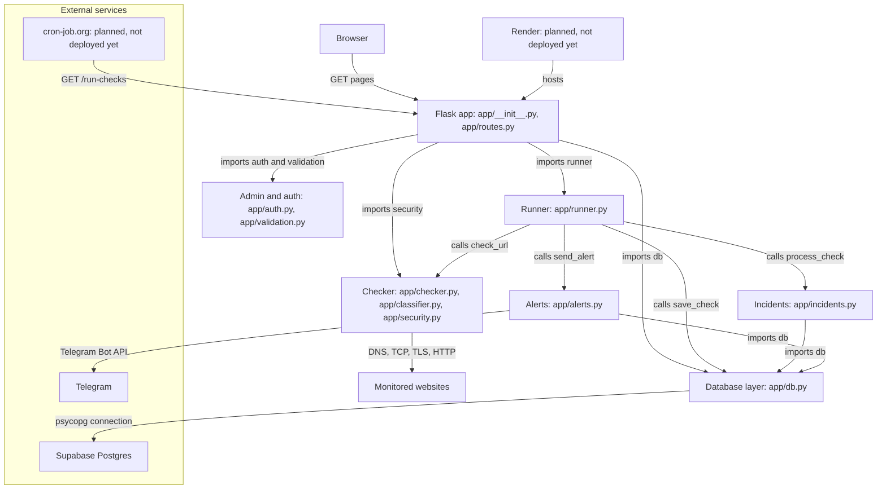

# WhyDown Architecture

This document shows the components of the WhyDown monitor and the data and control flow between them.

## 1. System overview

Boxes marked planned are not deployed yet.

<!-- NEXT -->
