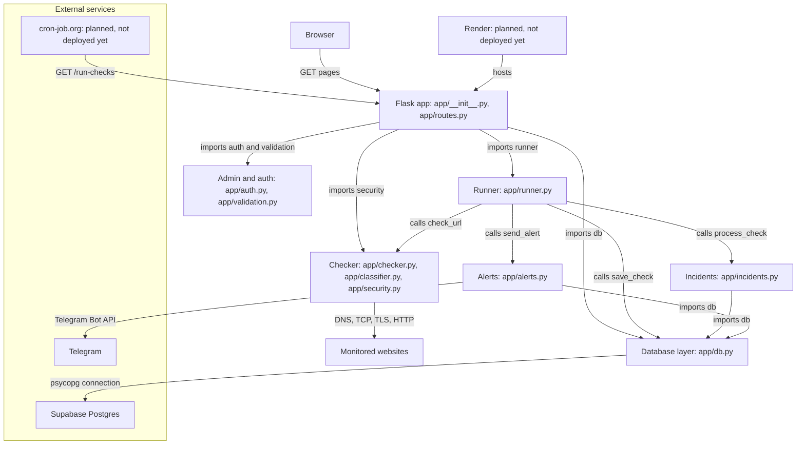
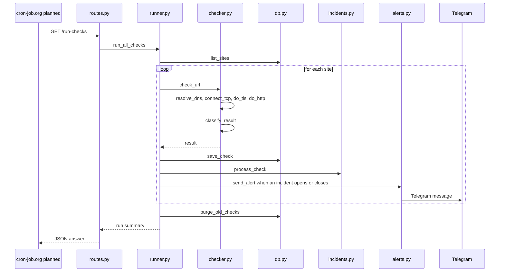
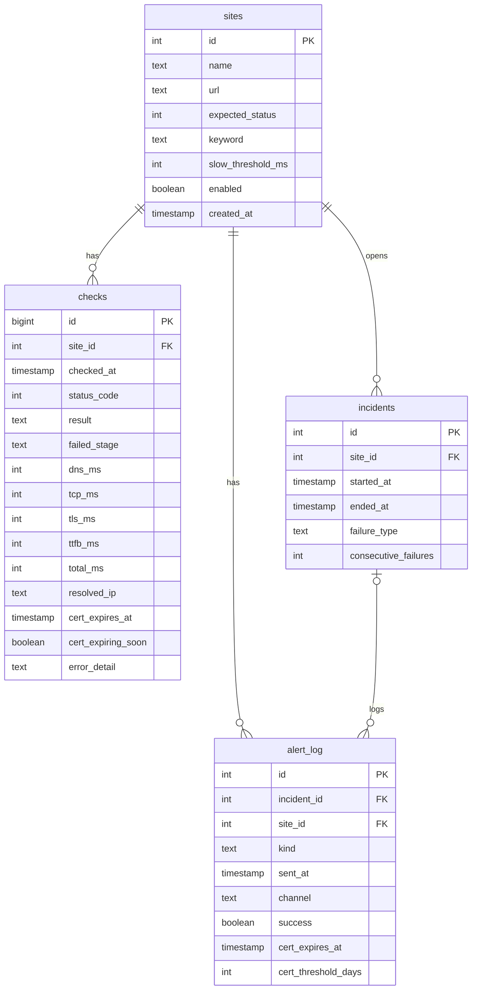

# WhyDown Architecture

This document shows the components of the WhyDown monitor and the data and control flow between them.

## 1. System overview

Boxes marked planned are not deployed yet.

## 2. One check run

This sequence diagram shows one scheduled run, triggered by the planned external scheduler.

Function names are taken from the code; the scheduler is planned, not deployed yet.

## 3. Database

This diagram shows the tables defined in docs/init_db.sql.

Source: docs/init_db.sql. Column types are simplified.

## 4. Source map

| Component | File | Role |
|---|---|---|
| Browser | none | Reads the dashboard, incidents and admin pages served by the Flask app |
| Flask app | app/__init__.py, app/routes.py | Creates the application; serves pages, the JSON API and /run-checks |
| Admin and auth | app/auth.py, app/validation.py | Admin login with CSRF tokens and a login rate limit; validation of site input |
| Runner | app/runner.py | Runs all site checks with a per-site timeout and a run deadline, then saves the results |
| Checker | app/checker.py, app/classifier.py, app/security.py | check_url does DNS, TCP, TLS and HTTP; classify_result sets the result code; security blocks private targets |
| Database layer | app/db.py | All SQL, through psycopg |
| Incidents | app/incidents.py | process_check opens and closes incidents from check results |
| Alerts | app/alerts.py | Sends Telegram DOWN, RECOVERY and certificate-expiry alerts and logs them in alert_log |
| Monitored websites | none | Sites stored in the sites table and checked over the network |
| Supabase Postgres | docs/init_db.sql | Hosted Postgres database; this file holds the schema |
| Telegram | app/alerts.py | Receives alert messages through the Bot API |
| cron-job.org | none | Planned scheduler that calls /run-checks; not deployed yet |
| Render | render.yaml | Planned hosting; render.yaml defines the service; not deployed yet |
| Configuration (not drawn in section 1) | app/config.py | Settings such as the runner timeouts |

## Not confirmed

- The diagrams were checked on mermaid.live only. The GitHub preview of this file did not finish loading when it was tried.
- Section 2 shows only the scheduled check run. It does not show certificate-expiry alerts (send_cert_alert is imported at app/runner.py line 33) or dashboard page requests.
- No arrow is drawn from Admin and auth to the database layer, because no import of it was found in app/auth.py or app/validation.py.
- Render and cron-job.org are planned. The render.yaml startCommand (app:create_app) has not been tested with gunicorn.
- Section 3 simplifies the column types and does not draw the indexes in docs/init_db.sql.
